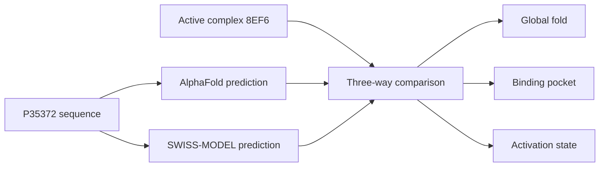

<div align="center">

# 🧬 One receptor, three realities

### A structural field trip through the human μ-opioid receptor

[](https://github.com/Ci-yo/BIO220_CW2_MOR-Structure/actions/workflows/repository-check.yml)


*The experimental structure catches the receptor in company: morphine, Gi and stabilising partners reveal the active state.*

</div>

## The mystery

If three structures describe the same receptor, why do they not tell exactly the same biological story?

This project follows the 400-residue human μ-opioid receptor through three structural “snapshots”: an AlphaFold prediction, a template-based SWISS-MODEL structure and the active cryo-EM complex **8EF6**. The aim is not simply to find the smallest RMSD, but to ask how confidence, template choice and activation state shape interpretation.

## Meet the three suspects

| Structure | What it brings to the case | Main limitation |
|---|---|---|
| 🔵 **AlphaFold** | A strong sequence-first model of the seven-helix receptor core | Flexible termini are uncertain and the conformation is inactive/intermediate-like |
| 🟢 **SWISS-MODEL** | An active-state, template-guided view | Its close agreement partly reflects the use of an active μOR template |
| 🟡 **8EF6** | Experimental context: morphine-bound μOR coupled to Gi | One stabilised experimental state, not the receptor's full dynamic range |

## The reveal


| Model compared with 8EF6 | TM-score | RMSD | Aligned residues | Coverage |
|---|---:|---:|---:|---:|
| AlphaFold | 0.96 | 1.43 Å | 284 / 367 | 77.4% |
| **SWISS-MODEL** | **1.00** | **0.40 Å** | **287 / 367** | **78.2%** |

Both predictions recover the overall GPCR fold. SWISS-MODEL is the closer active-state match, while AlphaFold provides a convincing fold without fully reproducing the intracellular rearrangement associated with activation. In other words: **a good structure is not automatically the right biological state**.

## Two clues worth zooming into

| Confidence map | Orthosteric pocket |
|---|---|
|  |  |
| The transmembrane core is much more reliable than the flexible termini. | Key pocket residues are captured, but side-chain placement adds another layer of difference. |

<details>
<summary><strong>🔍 Open the second pocket comparison</strong></summary>


The active-state template helps SWISS-MODEL reproduce the experimental pocket, including the orientation around D149. AlphaFold remains close for several neighbouring residues, showing why local inspection matters even when global scores look excellent.

</details>

## Investigation route



## Explore it yourself

Clone the repository, open PyMOL from its root and run:

```pml
@scripts/compare_models.pml
```

The script loads, colours and aligns the two predicted models. The experimental assembly is included separately for deeper exploration.

## Repository map

```text
├── data/          sequence, confidence regions and comparison metrics
├── structures/    AlphaFold, SWISS-MODEL and experimental coordinates
├── figures/       the visual evidence used in this story
└── scripts/       PyMOL exploration and repository validation
```

## Data trail

- [UniProt P35372 — human μ-opioid receptor](https://www.uniprot.org/uniprotkb/P35372/entry)
- [AlphaFold DB entry P35372](https://alphafold.ebi.ac.uk/entry/P35372)
- [RCSB PDB 8EF6](https://www.rcsb.org/structure/8EF6)

---

<div align="center">

**BIO220 CW2 · built as a small, reproducible structural biology story**

</div>
