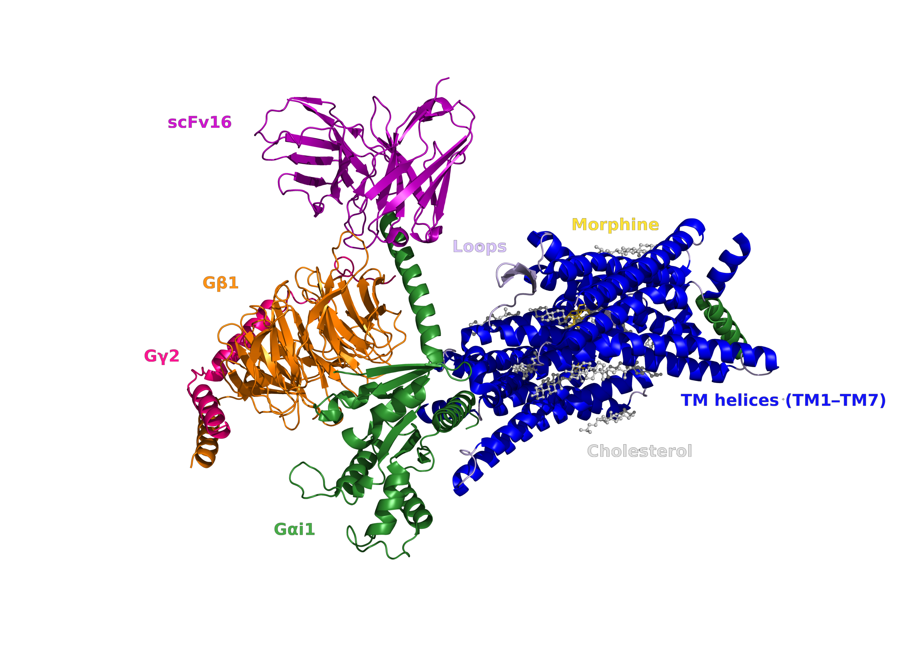
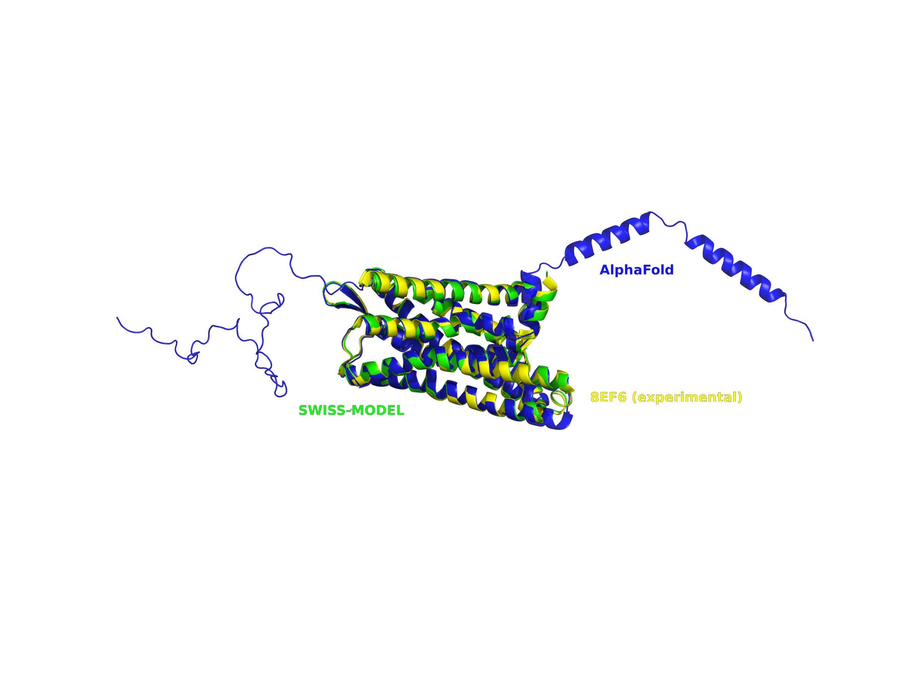
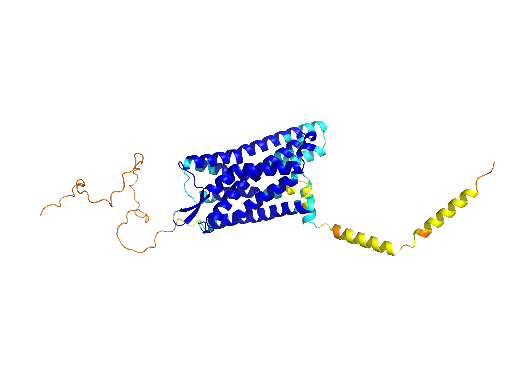
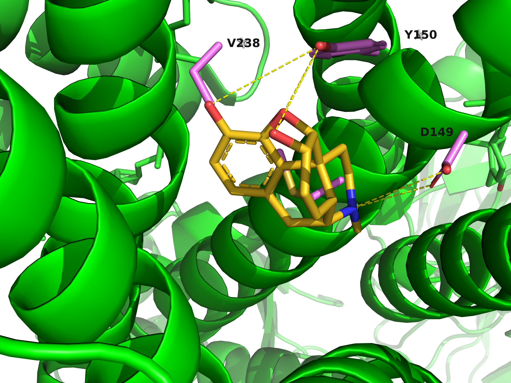
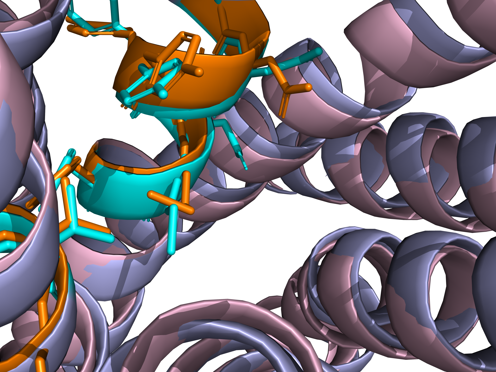
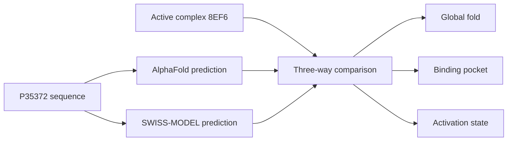

<div align="center">

# 🧬 One receptor, three realities

### A structural field trip through the human μ-opioid receptor

[](https://github.com/Ci-yo/BIO220_CW2_MOR-Structure/actions/workflows/repository-check.yml)




*The experimental structure catches the receptor in company: morphine, Gi and stabilising partners reveal the active state.*

</div>

## Step-by-step guide

### 1. Prepare your computer and get the files

Use [Python 3.10 or later](https://www.python.org/downloads/).
Check `python --version` in your terminal. On Windows, select the installer's
option to add Python to PATH, or use `py` in place of `python`.
Install PyMOL separately if you want an interactive structure view. Install [Git](https://git-scm.com/downloads) to use the commands below.
Run them in a **terminal** (PowerShell on Windows; Terminal on macOS/Linux):

```bash
git clone https://github.com/Ci-yo/BIO220_CW2_MOR-Structure.git
cd BIO220_CW2_MOR-Structure
```

Alternatively, use **Code → Download ZIP**, extract it, and open a terminal in
the extracted folder. All commands below start in the folder containing
`README.md`. A second run replaces the generated outputs named below.

### 2. Check the structure files

```bash
python scripts/validate_repository.py
```

The validator uses Python's standard library. Inspect:

| Input | Role |
|---|---|
| [`structures/alphafold-P35372.pdb`](structures/alphafold-P35372.pdb) | AlphaFold prediction. |
| [`structures/swissmodel-P35372.pdb`](structures/swissmodel-P35372.pdb) | Template-based prediction. |
| [`structures/8EF6-assembly1.cif.gz`](structures/8EF6-assembly1.cif.gz) | Experimental assembly, supplied separately. |
| [`data/model_comparison.csv`](data/model_comparison.csv) | Archived comparison measurements. |

### 3. Compare the two predicted structures

Start PyMOL, set its working directory to this repository, and run this in
the **PyMOL command line**:

```pml
@scripts/compare_models.pml
```

The script resets the scene, loads the two predictions, aligns their Cα
atoms, and displays AlphaFold in blue and SWISS-MODEL in green.
A superposition appears in the viewport; no figure file is automatically saved.

### 4. Add the experimental assembly

In the same PyMOL session:

```pml
load structures/8EF6-assembly1.cif.gz, experimental
show cartoon, experimental
```

Inspect the assembly's chains and identify the receptor before making any
receptor-only alignment. The assembly includes interacting partners.
The table's TM-scores and comparisons **against 8EF6** are archived results;
the supplied two-model `align` command does not reproduce those exact metrics.

### 5. Troubleshooting and interpretation

| Symptom | Action |
|---|---|
| `python` is not recognised | Check the Python installation; on Windows try `py --version`. |
| An input file cannot be found | Run from the repository root and extract the complete ZIP, not just the script. |
| PyMOL reports a missing relative path | Set its working directory to the folder containing `structures/`. |
| PyMOL cannot read the compressed CIF | Extract a local `.cif` copy with a gzip-capable archive tool, then load that copy. |
| The displayed alignment RMSD differs from the table | The command and table compare different structures/atom selections. Do not substitute one value for the other. |

The original interpretation, confidence plots and structural comparisons
follow below.

## The mystery

If three structures describe the same receptor, why do they not tell exactly the same biological story?

This project follows the 400-residue human μ-opioid receptor through three structural “snapshots”: an AlphaFold prediction, a template-based SWISS-MODEL structure and the active cryo-EM complex **8EF6**. The aim is not simply to find the smallest RMSD, but to ask how confidence, template choice and activation state shape interpretation.

## Meet the three suspects

| Structure | What it brings to the case | Main limitation |
|---|---|---|
| 🔵 **AlphaFold** | A strong sequence-first model of the seven-helix receptor core | Flexible termini are uncertain and the conformation is inactive/intermediate-like |
| 🟢 **SWISS-MODEL** | An active-state, template-guided view | Its close agreement partly reflects the use of an active μOR template |
| 🟡 **8EF6** | Experimental context: morphine-bound μOR coupled to Gi | One stabilised experimental state, not the receptor's full dynamic range |

## The reveal



| Model compared with 8EF6 | TM-score | RMSD | Aligned residues | Coverage |
|---|---:|---:|---:|---:|
| AlphaFold | 0.96 | 1.43 Å | 284 / 367 | 77.4% |
| **SWISS-MODEL** | **1.00** | **0.40 Å** | **287 / 367** | **78.2%** |

Both predictions recover the overall GPCR fold. SWISS-MODEL is the closer active-state match, while AlphaFold provides a convincing fold without fully reproducing the intracellular rearrangement associated with activation. In other words: **a good structure is not automatically the right biological state**.

## Two clues worth zooming into

| Confidence map | Orthosteric pocket |
|---|---|
|  |  |
| The transmembrane core is much more reliable than the flexible termini. | Key pocket residues are captured, but side-chain placement adds another layer of difference. |

<details>
<summary><strong>🔍 Open the second pocket comparison</strong></summary>



The active-state template helps SWISS-MODEL reproduce the experimental pocket, including the orientation around D149. AlphaFold remains close for several neighbouring residues, showing why local inspection matters even when global scores look excellent.

</details>

## Investigation route



## Repository map

```text
├── data/          sequence, confidence regions and comparison metrics
├── structures/    AlphaFold, SWISS-MODEL and experimental coordinates
├── figures/       the visual evidence used in this story
└── scripts/       PyMOL exploration and repository validation
```

## Data trail

- [UniProt P35372 — human μ-opioid receptor](https://www.uniprot.org/uniprotkb/P35372/entry)
- [AlphaFold DB entry P35372](https://alphafold.ebi.ac.uk/entry/P35372)
- [RCSB PDB 8EF6](https://www.rcsb.org/structure/8EF6)

---

<div align="center">

**BIO220 CW2 · built as a small, reproducible structural biology story**

</div>
